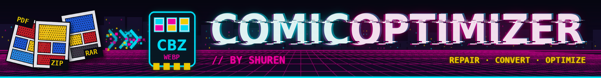

### 📚 ComicOptimizer v3.1.0

La soluzione definitiva per la gestione, riparazione e ottimizzazione della tua libreria di fumetti digitali.

Sviluppato con passione da **Michele** *"Shuren"* **Bancheri**, ComicOptimizer nasce dall'esigenza di trasformare collezioni disordinate e pesanti in librerie fluide, standardizzate e pronte per qualsiasi lettore.

### 🆕 Novità

**v3.1.0: marcatura dei pezzi del nome.** Nella finestra Rinomina selezioni col mouse un pezzo del nome e col tasto destro dici cos'è (Titolo, Numero, Anno, Autore, Editore, Edizione, Lingua, P1, P2…): la regola vale per tutti i file della finestra, anche con titoli di lunghezza diversa.

**v3.0.0: rinomina.** Rinomina uno o più fumetti dall'app (doppio click sul nome, F2 o il pulsante "Rinomina"), con uno schema libero come `<p1> - #<num> - <p3>`, i tasti "_ → spazio" e "Iniziali Maiuscole", e l'anteprima prima di toccare i file. Il pulsante "Aiuto" spiega tutto. **Nuovo look:** banner cyberpunk in cima, niente più riquadro di rilascio (i file si trascinano ovunque nella finestra) e lista che si pulisce da sola quando tutti i fumetti sono convertiti. **Selezione più comoda:** trascina il mouse per selezionare con un riquadro (la griglia scorre da sola), "Seleziona tutto" o `Ctrl+A`.

**v2.9.0: anteprima, cartelle e unione.** Nell'editor un doppio click apre la pagina in grande (frecce ← → per scorrere). Una cartella di sole immagini trascinata nell'app diventa un fumetto. Con "Unisci selezionati" più fumetti, anche di formati diversi, diventano un unico CBZ.

**v2.8.0: codice riorganizzato.** Il programma ora è diviso in più moduli (vedi [Struttura del progetto](#-struttura-del-progetto)) invece che in un unico file enorme. Il funzionamento non cambia, ma sviluppare e correggere diventa più semplice.

**v2.7: nuova interfaccia.** Pulsanti arrotondati, barre di scorrimento sottili e uno stile uniforme in tutta l'app. La barra in alto si adatta ai pulsanti visibili, il pulsante "Analizza" è stato rimosso (l'analisi parte da sola) e nel log il pulsante di salvataggio si chiama semplicemente "Salva".

**v2.6: più sicuro e più veloce.**

* **Originali al sicuro:** il nuovo CBZ viene verificato (integrità e numero di pagine) prima di toccare l'originale, che viene spostato nel cestino invece di essere cancellato.
* **Nessuna pagina persa:** le pagine molto leggere (bianche, crediti, WebP semplici) non vengono più scartate.
* **Metadati conservati:** il file ComicInfo.xml resta nell'archivio (utile per Komga, Kavita, YACReader...).
* **Conversione WebP su più core:** molto più veloce sulle raccolte grandi. Le pagine già in WebP non vengono ricompresse e, se il WebP pesa più dell'originale, la pagina resta com'è.
* **PDF migliori e più veloci:** le pagine-scansione vengono estratte nella qualità originale; le altre vengono renderizzate in JPEG (molto più leggero del vecchio PNG). I PDF lunghi usano più core.
* **Duplicati per contenuto:** riconosciuti anche con nomi diversi.
* **Fine lavoro:** riepilogo con spazio risparmiato e tempo impiegato, notifica di sistema e suono (disattivabili con "🔔 Avvisi").
* **Windows e Linux:** eseguibile per Windows (7-Zip incluso) e AppImage per Linux, compilati automaticamente.

Il dettaglio completo è in [CHANGELOG.md](CHANGELOG.md).

### 🚀 Cosa c'è di nuovo nella v2.0+

La **versione 2.0** segna un punto di svolta per il progetto:

* **Supporto PDF Nativo:** Conversione fluida da PDF a CBZ con estrazione immagini ad alta fedeltà.
* **Motore Turbo:** Gestione della memoria ottimizzata e velocità di elaborazione raddoppiata.
* **Interfaccia Asincrona:** Grazie a un sistema di threading avanzato, l'UI rimane reattiva anche durante la scansione di migliaia di file.
* **Gestione Conflitti:** Sistema intelligente per decidere se sovrascrivere, rinominare o saltare file esistenti.

### ✨ Funzionalità Principali

***🛠️ Standardizzazione Universale***

* **Conversione Totale:** Importa .pdf, .cbr, .rar, .zip e trasformali istantaneamente nello standard .cbz.
* **Ottimizzazione WebP:** Riduci drasticamente il peso della tua collezione senza sacrificare la qualità visiva.
* **Sanificazione Archivi:** Eliminazione automatica di file "spazzatura" come .DS_Store, __MACOSX o file temporanei.

### 🧠 Intelligenza e Controllo

* **Analisi Duplicati:** Riconosce come doppioni i file con lo stesso nome (es. .cbr e .cbz) e gli archivi con contenuto identico (stesso numero di pagine e stesse dimensioni delle immagini), anche se hanno nomi diversi. L'analisi parte in automatico quando aggiungi i file.
* **Advanced Editor:** Un editor visuale integrato per riordinare pagine, eliminare scansioni errate o aggiungere nuove immagini a un archivio esistente. Doppio click su una pagina per vederla in grande.
* **Cartelle di immagini:** una cartella che contiene solo immagini (anche in sottocartelle) diventa un unico fumetto, con le pagine in ordine naturale.
* **Unione di fumetti:** più fumetti selezionati diventano un unico CBZ, con nome e destinazione a scelta.
* **Rinomina:** uno o più fumetti, con uno schema del nome a scelta (numero già nel nome, progressivo, parti del nome), anteprima e nessuna sovrascrittura.
* **Integrazione di Sistema:** Duplicati e originali sostituiti finiscono nel cestino di sistema (send2trash, con gio trash come riserva su Linux).

### 📥 Download

Gli eseguibili si scaricano dalla pagina [Releases](https://github.com/Shuren81/ComicOptimizer/releases).

#### 🪟 Windows

Scarica lo zip **ComicOptimizer-…-windows.zip**, estrai TUTTA la cartella e avvia `ComicOptimizer.exe`. 7-Zip è già incluso, non serve installare nulla.

Al primo avvio Windows può mostrare l'avviso "Windows ha protetto il PC" perché l'eseguibile non è firmato: clicca **Ulteriori informazioni → Esegui comunque**.

Il log su Windows si trova in `%LOCALAPPDATA%\ComicOptimizer\comicoptimizer.log`.

#### 🐧 Linux (AppImage)

Scarica il file `.AppImage`, rendilo eseguibile e avvialo:

```bash
chmod +x ComicOptimizer-*.AppImage
./ComicOptimizer-*.AppImage
```

Per leggere i RAR servono `p7zip-full` e `unrar` (vedi sotto).

Il log dell'AppImage si trova in `~/.local/state/ComicOptimizer/comicoptimizer.log`.

Gli eseguibili vengono compilati automaticamente da GitHub Actions (`.github/workflows/build.yml`) ad ogni nuova Release.

### 📦 Installazione e Requisiti (Linux / da sorgente)

**1. Dipendenze di Sistema (Linux/Ubuntu/Mint)**

Per gestire gli archivi e i file PDF, apri il terminale e installa:

```bash
sudo apt update
sudo apt install p7zip-full unrar
```

**2. Dipendenze Python**

Installa le librerie necessarie tramite pip, dalla cartella del progetto:

```bash
pip install -r requirements.txt
```

(oppure, a mano: `pip install PyQt6 Pillow pymupdf send2trash`)

### 🛠️ Utilizzo Rapido

* **Avvio:** esegui `python3 main.py` dalla cartella del progetto.
* **Importazione:** trascina i tuoi file o cartelle in un punto qualsiasi della finestra (quando la lista è vuota la schermata è pulita: niente pulsanti, solo la scritta "Trascina qui i file" su un disegno al neon) (i file con estensioni non supportate non vengono importati). Una cartella di sole immagini diventa un fumetto: le pagine seguono l'ordine naturale, prima le immagini della cartella e poi quelle delle sottocartelle (se ci sono entrambe, l'app chiede se le immagini sciolte vanno prima o dopo). Nelle cartelle miste (immagini più archivi o PDF) vengono importati solo gli archivi.
* **Analisi:** viene effettuata in automatico. Ogni fumetto mostra il suo stato: da sistemare, ok, riparato, convertito, duplicato o danneggiato.
* **Selezione:** clicca sulle card per selezionarle, oppure trascina il mouse sulla griglia per selezionarne tante con un riquadro (con Ctrl il riquadro le toglie; vicino al bordo la griglia scorre da sola). Shift+click seleziona un intervallo, "Seleziona tutto" o `Ctrl+A` le seleziona tutte; con una selezione il pulsante diventa "Deseleziona tutto" (o `Esc`). Con una selezione compaiono "Rinomina" e "Cestina", con almeno due fumetti anche "Unisci"; "Sistema" chiede se sistemare i selezionati o tutti.
* **Unione:** "Unisci" unisce i fumetti in ordine naturale del nome. Scegli nome e destinazione, poi "Unisci" o "Unisci e converti" (WebP). Gli originali vanno nel cestino solo dopo la verifica del nuovo CBZ.
* **Ottimizzazione:** scegli se riparare i file (uniformare i numeri di pagina e convertire in .CBZ) o convertire le pagine in WebP per risparmiare spazio.
* **Ordinamento pagine:** per ogni file è possibile modificare l'ordine delle pagine, aggiungerne di nuove e/o rimuoverne. I numeri di pagina vengono adeguati. Doppio click su una pagina per vederla in grande (frecce ← → o pulsanti ◀ ▶ per scorrere, Esc per chiudere). Le nuove pagine caricate vengono inserite in fondo: **ricordati di spostarle manualmente nella posizione preferita**.
* **Rinomina:** doppio click sul nome nella card, tasto `F2` o il pulsante "Rinomina". Scrivi lo schema del nuovo nome (es. `<p1> #<p2> - <p3>`; autore, editore, edizione e lingua si scrivono nelle loro caselle (l'autore si può anche cercare online con "🔍 Cerca") e si inseriscono con `<aut>`, `<pub>`, `<edz>`, `<lang>`; nel menu a tendina ci sono gli ultimi schemi usati (🧹 li svuota) e tre schemi pronti: manga `<aut> - <tit> - Cap #<num>`, graphic novel `<aut> - <tit> (<anno>) (<lang>)`, serie americane `<tit> (<anno>) - #<num> - <sott> (<lang>)`; l'Aiuto spiega come conviene chiamare i file), sistema i nomi con Cerca/Sostituisci (jolly `?` e `*`, anche in Sostituisci per tenere il testo trovato: `[*]` → `*` toglie solo le parentesi) e gli interruttori "_ → spazio" e "Iniziali Maiuscole": la colonna "Nuovo nome" si aggiorna in tempo reale. Se la divisione automatica in pezzi non va bene, nel riquadro in alto selezioni col mouse un pezzo del nome e col tasto destro gli dai un ruolo (Titolo `<tit>`, Numero, Anno, Autore…, P1, P2…; anche Unisci, Dividi, Ignora, Azzera marcature): il segnaposto entra nello schema e la regola vale per tutti i file con la stessa struttura (gli altri restano rossi, "⚠ schema non applicabile"). Selezioni le righe con un click o trascinando (con righe selezionate si rinominano solo quelle), correggi a mano le celle se serve, poi "Rinomina": la finestra resta aperta per altri passaggi. "Annulla rinomina" rimette i nomi di prima. Le righe rosse non vengono toccate. Il pulsante "Aiuto" (o `F1`) spiega tutti i comandi.
* **Log:** il pulsante "Log" (o il tasto `L`) apre la finestra del log, con filtro per livello, ricerca e pulsante "Salva".

### 🧩 Struttura del progetto

```
main.py                   punto di avvio
comicoptimizer/
  config.py               versione, costanti, percorsi (APP_VERSION si cambia qui)
  logsetup.py             log su file, console e finestra di log
  utils.py                cestino, 7z/unrar, nomi, cartelle temporanee, formattazione
  pdf.py                  supporto PDF (PyMuPDF)
  archives.py             lettura, controllo ed estrazione degli archivi
  images.py               preparazione e conversione delle pagine (WebP...)
  cbz.py                  creazione e verifica dei CBZ, ComicInfo.xml
  workers.py              thread di lavoro (importazione, analisi, elaborazione...)
  style.py                foglio di stile (QSS)
  dialogs.py              finestra di log, interruzione, unione, rinomina, widget generici
  card.py                 card di un fumetto nella griglia
  editor.py               editor avanzato delle pagine
  main_window.py          finestra principale
  app.py                  avvio dell'applicazione Qt
tests/                    test automatici (venv/bin/python tests/test_rename.py, test_selection.py, test_layout.py, test_platform.py, test_processing.py, test_online.py, test_maximize.py)
tools/make_banner.py      genera il banner (comicoptimizer_banner.png)
tools/make_drop_art.py    genera il disegno della lista vuota (comicoptimizer_drop.png)
tools/build_appimage.sh   compila l'AppImage in locale
tools/build_windows.ps1   compila l'exe per Windows in locale
tools/build_macos.sh      compila l'app per macOS (DMG) su un Mac
.github/workflows/        compilazione automatica (Windows e AppImage)
```

**Compilare in locale** (senza GitHub):

* **AppImage (Linux):** dalla cartella del progetto, con il `venv` già pronto: `bash tools/build_appimage.sh`. La prima volta scarica `appimagetool`. Il risultato è `ComicOptimizer-v<versione>-x86_64.AppImage`. Un'AppImage compilata su un sistema recente parte solo su sistemi uguali o più recenti.
* **Windows:** serve un PC Windows con Python 3.12 (da python.org, con "Add python.exe to PATH") e 7-Zip (da 7-zip.org). Da PowerShell nella cartella del progetto: `powershell -ExecutionPolicy Bypass -File tools\build_windows.ps1`. Il risultato è `ComicOptimizer-v<versione>-windows.zip` (l'exe è anche in `dist\ComicOptimizer`).

* **macOS:** serve un Mac con Python 3.12 (installer da python.org) e 7-Zip per macOS: scarica da [7-zip.org](https://www.7-zip.org/download.html) l'archivio "macOS" ed estrailo in `tools/7zip-mac/` (devono esserci `7zz` e `License.txt`; 7-Zip legge anche i RAR, `unrar` non serve). Dal Terminale nella cartella del progetto: `bash tools/build_macos.sh`. Il risultato è `ComicOptimizer-v<versione>-macos-<arm64|x86_64>.dmg`: l'app funziona sui Mac con lo stesso processore (Apple Silicon o Intel) di quello che l'ha compilata. Non è firmata: su un altro Mac, la prima volta si apre con **tasto destro → Apri**. Il log è in `~/Library/Logs/ComicOptimizer`.

Gli script usano le stesse opzioni della compilazione automatica su GitHub (`.github/workflows/build.yml`).

### 🛡️ Privacy e Sicurezza

**100% Locale:** Nessun dato o immagine viene caricato su server esterni. Tutto avviene sul tuo PC. Unica eccezione, solo se la usi tu: il pulsante *Cerca* dell'autore (finestra Rinomina) invia a Wikidata e AniList **solo il titolo** che confermi, mai i file né il percorso. Senza premerlo l'app non usa Internet.

**Resilienza:** Se interrompi un'operazione, i tuoi file originali rimangono intatti: vengono spostati nel cestino solo dopo che il nuovo archivio è stato creato e verificato. Se il cestino non è disponibile (per esempio su un disco di rete) l'originale resta al suo posto: nulla viene mai cancellato definitivamente. Le cartelle temporanee vengono sempre ripulite.

### ☕ Sostieni il progetto

ComicOptimizer è gratuito. Se ti è utile, puoi lasciare una mancia con il pulsante *Sponsor* di GitHub, su [Ko-fi](https://ko-fi.com/shuren81) o su [PayPal](https://paypal.me/MicheleBancheri).

### ✍️ Note dell'Autore

"ComicOptimizer nasce per mettere ordine nel caos digitale. 

Un ringraziamento speciale a mia moglie, la scrittrice [Keyla Damaer](https://keyladamaer.com/), per il suo supporto costante."

### 🤖 Ringraziamenti all'IA

Questo progetto è stato scritto con l'aiuto dell'intelligenza artificiale, e non c'è niente da nascondere:

* **Gemini** ha accompagnato le prime versioni, rispondendo alle domande esistenziali sul codice alle tre di notte.
* **Claude** (Anthropic) ha scritto, riscritto e testato buona parte del codice dalla 2.6 in poi: correzioni, conversione WebP su più core, PDF più veloci, nuova interfaccia, versioni per Windows e Linux e la divisione in moduli. Ha anche cancellato senza lamentarsi una funzione intera, quando abbiamo cambiato idea.

Le idee, le decisioni e i collaudi sono di Michele: l'IA scrive il codice e ogni tanto da qualche suggerimento.

***Creato con ❤️ per i collezionisti di fumetti.***
